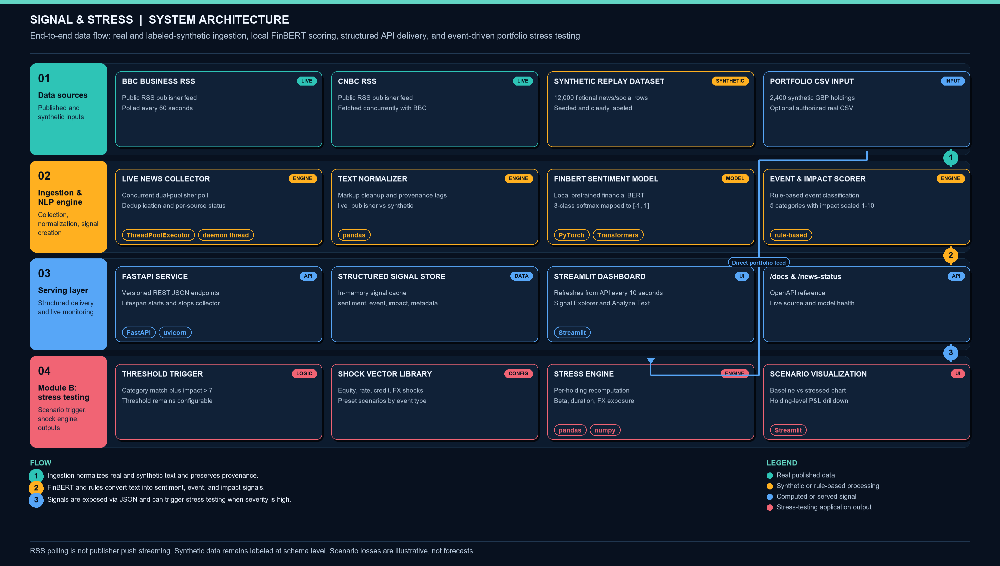

# Signal & Stress - S&P Global & Crisil Campus Hackathon

**Candidate Name:** SHARAN R  
**College Email ID:** sharan.r2022@vitstudent.ac.in  
**College / Campus:** VELLORE INSTITUTE OF TECHNOLOGY (VIT)  
**Demo Video Link:** PENDING - add a public or unlisted demo video URL before submission  
**Slide Deck Link:** [Six-slide presentation](docs/presentation.pdf)  
**Public Repository:** [vit-sharan-r-hackathon](https://github.com/shaaran-r/vit-sharan-r-hackathon)

## 1. Project Overview / Problem Statement & Approach

Financial risk analysts must connect rapidly arriving, unstructured business
news to portfolio exposures. Signal & Stress turns publisher headlines into
structured sentiment, event categories and impact estimates, then demonstrates
their downstream use through Module B: strategic portfolio stress testing.
Module A is outside this project's scope.

The modular Python engine continuously polls two real publishers, normalizes
their records and runs pretrained FinBERT locally for sentiment. Keyword rules
classify events and estimate impact severity. FastAPI makes these signals
available to a Streamlit dashboard and an event-driven stress engine. The
dashboard includes searchable signals, highlighted keyword cues, editable
quick-start examples and baseline-versus-stressed portfolio visualizations.

The default demo combines real news with a clearly labeled synthetic
wholesale-style portfolio. Optional fictional news/social replay demonstrates
an arriving stream without pretending to be real activity. This is a
hackathon decision-support prototype: scenario losses are illustrative, not
forecasts, investment advice or a production valuation system.

## 2. Architecture & Tech Stack



- **Backend:** FastAPI, Pydantic and Uvicorn.
- **Dashboard:** Streamlit; refresh every 10 seconds when enabled.
- **AI/NLP:** PyTorch and Transformers; pretrained ProsusAI FinBERT sentiment,
  with heuristic event classification and impact scoring.
- **Data processing:** pandas and NumPy; Requests and XML parsing for RSS.
- **Configuration:** python-dotenv; optional local secrets excluded from Git.
- **Storage:** CSV/JSONL demo datasets and bounded in-memory caches; no database.

An API-lifecycle worker polls BBC and CNBC in parallel every 60 seconds, even
without dashboard viewers. Each snapshot contains up to 25 headlines per
publisher, deduplicated by stable IDs. Both sources are independent live
integrations; Twitter/X is not integrated. Provider availability and collection
time are exposed through the API. Invalid publication dates are skipped and
logged. One publisher failure does not block the other; an all-provider outage
is explicit rather than silently presenting stale news as current.

News collection is **external RSS polling, not publisher push streaming or a
stock-price feed**. Publication latency is outside the application's control.
Sentiment inference is cached by text/backend/model and runs locally.

### Repository structure

```text
vit-sharan-r-hackathon/
|-- README.md
|-- requirements.txt
|-- LICENSE
|-- run_demo.py
|-- src/
|   |-- api/
|   |-- dashboard/
|   |-- risk_engine/
|   |-- stress_testing/
|   |-- simulation.py
|   `-- prepare_finbert.py
|-- data/simulation/
|   |-- events.jsonl
|   |-- portfolio.csv
|   `-- manifest.json
|-- docs/
|   |-- presentation.pdf
|   |-- architecture.png
|   `-- generate_assets.py
`-- tests/
```

The suggested public repository name is `vit-sharan-r-hackathon`.
The current workspace folder need not be renamed to run the application.
The code is licensed under [MIT](LICENSE). Verify that the repository is public
and contains the complete submission before submitting.

## 3. Dataset Used

The supplied dataset clarification permits self-generated synthetic data or
public datasets representing the problem. This prototype does not claim to use
organizer-provided transactions or actual bank customer data.

| Dataset | Source | Size and purpose |
| --- | --- | --- |
| Live news | [BBC Business RSS](https://feeds.bbci.co.uk/news/business/rss.xml) and [CNBC RSS](https://www.cnbc.com/id/10001147/device/rss/rss.html) | Up to 25 headlines per publisher per collection; URLs and publication timestamps retained |
| Synthetic news/social | [Local seeded generator](src/simulation.py), seed 20261008 | 12,000 fictional records: 6,000 news and 6,000 social posts; five event categories plus General Market |
| Synthetic portfolio | Same local generator | 2,400 holdings across 240 fictional issuers, five asset types, six sectors and four regions |
| Quick-start cases | [Authored examples](src/dashboard/examples.py) | Six editable fictional cases for sentiment, classification and threshold demonstrations |
| Optional uploaded portfolio | User-provided authorized, non-confidential CSV | Source, valuation date and currency declared by the user; not independently verified |

Downloadable demo data is stored in [events.jsonl](data/simulation/events.jsonl),
[portfolio.csv](data/simulation/portfolio.csv) and
[manifest.json](data/simulation/manifest.json). The manifest records generation
time, seed, counts, baseline value and methodology.

### Assumptions and limitations

- Synthetic entities, events and social identities are fictional. News/social
  replay represents two simulated text channels, not genuine social integrations.
  Templates are aligned with keyword rules; tests on them are not independent
  evidence of accuracy on unrestricted real-world language.
- The portfolio contains 480 holdings per type: loan, bond, equity, derivative
  and cash. Balanced allocation is a demo choice, not an observed bank allocation.
- All values are GBP. `notional` means current holding value, **not derivative
  contractual notional**. Ratings/maturities are illustrative metadata.
- Rate durations, equity betas, credit durations and signed FX exposures are
  bounded fictional assumptions, not historically estimated sensitivities.
  Cash has zero modeled sensitivities. Derivatives use a simplified linear model.
- Replay displays 120 records and advances by six every 10 seconds, cycling
  through the corpus. Replay emission time is distinct from `dataset_timestamp`.
  Regeneration reproduces seeded content/values; dates depend on generation time.
- FinBERT sentiment is pretrained. Event classification and 1-10 impact scores
  are heuristic estimates, not validated market-impact predictions.
- Stress scenarios are independent assumptions, not forecasts. Do not sum their
  losses as if they represented one joint event.
- Alpha Vantage is an optional adapter, currently disabled locally after access
  rejection. It is not an active demo dataset. GDELT is not used in live mode.

### Portfolio CSV contract

```text
asset_id,asset_type,description,notional,duration,equity_beta,credit_duration,currency_exposure
```

Identifiers must be unique and non-empty; descriptions must be non-empty.
Allowed types: loan, bond, equity, derivative and cash. Values must be finite,
holding values and durations non-negative, and total value positive.
`duration` and `credit_duration` are years; `equity_beta` is equity sensitivity;
`currency_exposure` is signed FX-sensitive value in the selected base currency.
The app does not invent missing sensitivities or convert currencies.

Real uploads must be UTF-8 CSV, at most 2 MB, with a source reference,
non-future valuation date, three-letter uppercase currency and authorization
confirmation. Zero exposure must mean known zero, not unknown.
Uploads are not persisted to disk or sent to news providers. The synthetic
portfolio requires no false attestation that generated holdings are real.

## 4. Quickstart & Installation

**Runtime:** Python 3.12 tested on Windows; Python 3.10+ supported.  
**Network:** Verified HTTPS access to publisher feeds and official model assets
is needed for initial setup. CPU inference is supported.

Clone the repository using the commands below. If using the existing workspace,
skip the clone/change-directory commands.

```powershell
git clone https://github.com/shaaran-r/vit-sharan-r-hackathon.git
Set-Location vit-sharan-r-hackathon
python -m venv .venv
.\.venv\Scripts\Activate.ps1
python -m pip install -r requirements.txt
python -m src.simulation
python -m src.prepare_finbert
$env:SENTIMENT_BACKEND = "finbert"
python run_demo.py
```

**Exact demo entry point: `python run_demo.py`**

- Dashboard: <http://localhost:8501/>
- API documentation: <http://localhost:8000/docs>
- Health: <http://localhost:8000/health>

Generate demo datasets once before startup; regeneration replaces only the
three named simulation files. Restart the API to reload its cached catalogue.
The launcher starts the API and dashboard; stop with Ctrl+C.

### FinBERT model setup

[prepare_finbert.py](src/prepare_finbert.py) downloads the official ProsusAI
Financial PhraseBank sentiment checkpoint from the alternate URL documented
in the [publisher repository](https://github.com/ProsusAI/finBERT), plus the
matching BERT-base-uncased vocabulary. It strictly loads weights and serializes
them as safetensors in `models/finbert`, recording provenance. TLS verification
is never disabled. Allow approximately 1 GB of disk space for model assets.

Local prepared weights are preferred; otherwise the engine loads
`ProsusAI/finbert` from Hugging Face. `FINBERT_MODEL` may select another directory
or model ID. Model loading is lazy; readiness is confirmed only after successful
loading. Label mapping is 0 positive, 1 negative, 2 neutral. Inference truncates
to 512 tokens.

If neither official source is accessible, errors are explicit. For an
intentionally heuristic demo only:

```powershell
$env:SENTIMENT_BACKEND = "lexicon"
python run_demo.py
```

This is not a silent fallback and must not be described as trained-model inference.
Environment variables take precedence over a local `.env` configuration.

### Optional provider and secret hygiene

Leave `ALPHA_VANTAGE_API_KEY` empty to disable that adapter. If configured, its
key is sent only to the official Alpha Vantage HTTPS endpoint. Successes and
failures are cached in memory for two hours; restart clears the cache and may
consume another request. This is not a quota guarantee. Access errors are shown
while RSS continues. There is no historical-price integration.

Never publish `.env`, `.streamlit/secrets.toml`, `.venv` or model binaries.
These paths are excluded by `.gitignore`. Provider status does not expose keys.
Public RSS access does not grant unrestricted rights to redistribute publisher
articles; the demo ingests headlines with attribution and links, not full articles.

### Tests and documentation assets

```powershell
python -m unittest discover -s tests -v
python -m compileall -q src tests run_demo.py
```

The latest verified suite passed 37 tests. Artificial test records remain in
tests. Tests validate behavior, not predictive financial accuracy.

To regenerate the diagram and six-slide PDF using Pillow (already included by
the dashboard dependency):

```powershell
python docs\generate_assets.py
```

### API reference

| Endpoint | Purpose |
| --- | --- |
| `GET /health` | Service availability |
| `GET /signals?mode=live` | Real-news signals; optional `mode=hybrid` adds labeled replay |
| `GET /news-status` | Publisher collection, model readiness and optional provider status |
| `POST /analyze` | Analyze text, source, entities and optional synthetic provenance |
| `POST /portfolio/validate` | Validate portfolio and provenance |
| `POST /stress-test` | One event and threshold with a required portfolio |
| `POST /stress-tests` | Batch scenarios; optional representative summaries |
| `GET /simulation/status` | Generation manifest and replay tick |
| `GET /simulation/portfolio` | Synthetic portfolio request and summary |
| `GET /simulation/download/{dataset}` | Download portfolio CSV, events JSONL or manifest JSON |

Portfolio objects contain `csv_text`, `source_reference`, `valuation_date`,
`currency`, and either `authorized_real_data: true` or `data_origin: synthetic`.
Single stress requests add `event_classification`, `impact_score`, optional
`event_id` and `min_impact`; batch requests accept `mode` and `representative_only`.
Legacy fixture mode is rejected. `GET /stress-tests` returns HTTP 409 explaining
the required POST request. Invalid inputs, provider outages and model failures
are explicitly reported.

## 5. Key Results & Domain Impact

- Verified real ingestion from BBC and CNBC, with 25 headlines each, and a
  subsequent unattended background collection.
- Verified local FinBERT positive (+0.84), negative (-0.82) and neutral (0.00)
  sentiment on three smoke-test sentences. This is not a held-out benchmark.
- Structured outputs include sentiment in [-1, 1], event classification,
  impact in [1, 10], source, timestamp and provenance.
- The bundled synthetic portfolio baseline is GBP 14,685,727,454.43.
  The geopolitical scenario produces GBP 13,392,991,408.98, approximately
  -8.80%. These values apply to the bundled dataset, not actual holdings.
- Module B applies equity, rates, credit-spread and FX shocks with holding-level
  P&L and zero-clipped stressed values. Default trigger is impact >=7; set the
  dashboard threshold to 8 to demonstrate the brief's example of impact >7.
- Quick cases, cue highlights, filtering, exports and allocation charts help
  an analyst inspect how a headline leads to a hypothetical exposure change.
  Highlights reuse keyword dictionaries; they are not FinBERT attributions and
  do not resolve negation, rumors or factual accuracy.

The intended business benefit is faster, traceable scenario exploration:
headline -> structured signal -> threshold -> shock -> portfolio estimate.
No measured analyst-time saving, investment return or production accuracy is
claimed. Further work includes unseen-headline evaluation, calibrated impact
estimation, exposure-specific shocks and fuller derivative valuation.

### Suggested reviewer demo

1. Open Overview: confirm live publisher labels and trained FinBERT status.
2. Open Analyze text: load Debt default, submit and inspect highlighted cues.
3. Inspect the event/impact result and baseline-versus-stressed portfolio.
4. Set threshold to 8 and demonstrate a geopolitical event with impact >7.
5. Open Dataset studio: review provenance, allocations and full downloads.
6. Show API documentation and the test command.

### Submission checklist

- [x] Candidate details, setup, architecture, dataset assumptions and results.
- [x] MIT license, source code, sample data, six-slide PDF and architecture PNG.
- [ ] Publish a public repository named `vit-sharan-r-hackathon`.
- [ ] Replace the repository URL placeholder with the actual URL.
- [ ] Record/upload the demo and replace the demo-video placeholder.
- [ ] Review the deck, links and fresh-clone setup before final submission.
